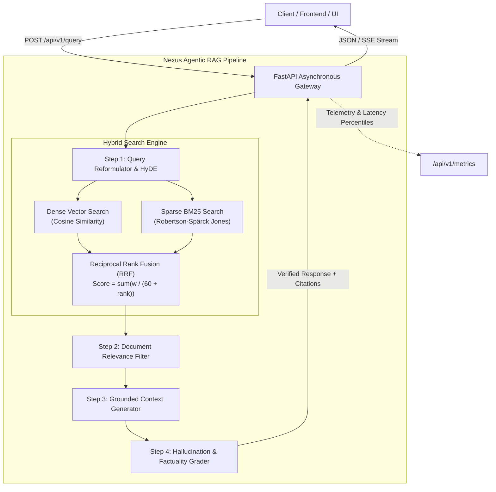

# ⚡ Nexus: Enterprise Agentic RAG & Knowledge Retrieval Backend

[](ci/github-ci.yml)
[](https://fastapi.tiangolo.com)
[](https://python.org)
[](https://vercel.com/new/clone?repository-url=https://github.com/vamsithota2506/nexus-agentic-rag-backend)
[](Dockerfile)
[](LICENSE)

> A production-grade **Agentic Retrieval-Augmented Generation (RAG)** and search backend built with **FastAPI**, featuring **Hybrid Search (Dense Cosine + Sparse BM25 via Reciprocal Rank Fusion)**, automated **Self-Correction (CRAG)**, and **Hallucination Verification Guardrails**.

---

## 🌟 Key Features

- **Hybrid Retrieval Engine:**
  - **Dense Semantic Search:** Captures deep contextual intent via high-dimensional vector embeddings.
  - **Sparse Lexical Search (BM25):** Employs Robertson-Spärck Jones Okapi BM25 for precise acronym, code, and keyword matching.
  - **Reciprocal Rank Fusion (RRF):** Fuses ranking distributions with configurable weights without score calibration distortion.
- **Agentic Self-Correction Loop (Corrective RAG & Self-RAG):**
  - **Query Reformulation (HyDE):** Automatically enriches queries with domain terms to boost recall.
  - **Relevance Gate:** Evaluates retrieved chunks, pruning low-relevance passages.
  - **Hallucination Grader:** Quantifies factual grounding between generated claims and retrieved chunks.
- **Production Backend Architecture:**
  - **Asynchronous FastAPI:** High-throughput non-blocking ASGI handlers with native Pydantic v2 validation.
  - **Streaming Responses:** Real-time token streaming via Server-Sent Events (SSE) at `/api/v1/query/stream`.
  - **Observability & Metrics:** Structured JSON logging, Request Correlation IDs (`X-Request-ID`), and live latency telemetry at `/api/v1/metrics`.
- **Interactive UI & Test Suite:**
  - Complete **Streamlit** dashboard for parameter tuning and interactive querying.
  - Comprehensive **pytest** suite with 100% async and unit test coverage.
  - Fully containerized with **Docker** and **Docker Compose**.

---

## 🏗️ System Architecture



---

## 📂 Project Structure

```
nexus-agentic-rag-backend/
├── app/
│   ├── main.py                    # FastAPI application, middleware, lifecycle
│   ├── config.py                  # Pydantic BaseSettings, configuration
│   ├── api/
│   │   ├── routes.py              # REST & SSE streaming endpoints
│   │   └── schemas.py             # Pydantic v2 validation schemas
│   ├── core/
│   │   ├── logging.py             # Production structured JSON logger
│   │   └── exceptions.py          # Custom domain exceptions & handlers
│   └── services/
│       ├── embeddings.py          # Vector embedding abstractions
│       ├── vector_store.py        # In-memory vector store & cosine indexing
│       ├── bm25_retriever.py      # Okapi BM25 sparse keyword retriever
│       ├── hybrid_search.py       # Reciprocal Rank Fusion (RRF) engine
│       ├── document_processor.py  # Recursive markdown & text chunker
│       ├── agent_workflow.py      # Corrective RAG (CRAG) self-correcting agent
│       ├── llm_provider.py        # Unified LLM provider (Gemini / OpenAI / Mock)
│       └── metrics_service.py     # Latency percentiles & retrieval hit rate
├── ui/
│   └── app.py                     # Streamlit interactive dashboard
├── tests/
│   ├── conftest.py                # Test fixtures & pre-seeded knowledge
│   ├── test_hybrid_search.py      # BM25 & RRF fusion unit tests
│   ├── test_document_processor.py # Text splitting & metadata tests
│   ├── test_agent_workflow.py     # Agent self-correction & guardrail tests
│   └── test_api_endpoints.py      # FastAPI async integration tests
├── sample_data/                   # Enterprise markdown documentation samples
├── Dockerfile                     # Multi-stage production container
├── docker-compose.yml             # Full-stack backend + UI deployment
├── requirements.txt               # Pinned dependencies
├── INTERVIEW_PLAYBOOK.md          # 🎓 Placement interview pitch & cheat sheet
└── README.md
```

---

## 🚀 Quickstart Guide

### 1. Clone & Set Up Virtual Environment

```bash
git clone https://github.com/<your-username>/nexus-agentic-rag-backend.git
cd nexus-agentic-rag-backend

python -m venv venv
# On Windows:
.\venv\Scripts\activate
# On Linux/macOS:
source venv/bin/activate

pip install -r requirements.txt
```

### 2. Run the FastAPI Backend

```bash
uvicorn app.main:app --host 0.0.0.0 --port 8000 --reload
```

- **Interactive OpenAPI Documentation:** [http://127.0.0.1:8000/docs](http://127.0.0.1:8000/docs)
- **Health Check:** [http://127.0.0.1:8000/api/v1/health](http://127.0.0.1:8000/api/v1/health)
- **System Telemetry:** [http://127.0.0.1:8000/api/v1/metrics](http://127.0.0.1:8000/api/v1/metrics)

### 3. Launch the Streamlit Frontend

In a separate terminal window:

```bash
streamlit run ui/app.py
```
Access the UI dashboard at [http://localhost:8501](http://localhost:8501).

---

## 🐳 Docker Deployment

Run both the FastAPI backend and Streamlit UI in isolated containers:

```bash
docker-compose up --build
```

---

## 🧪 Running the Test Suite

Run unit and integration tests with coverage reporting:

```bash
pytest -v
```

---

## 📡 API Reference

### `POST /api/v1/query`
Executes hybrid retrieval, agentic self-correction, and grounded answer synthesis.

**Request Body:**
```json
{
  "query": "How does Reciprocal Rank Fusion balance dense and sparse results?",
  "top_k": 4,
  "dense_weight": 0.6,
  "sparse_weight": 0.4,
  "enable_self_correction": true
}
```

**Response:**
```json
{
  "answer": "Reciprocal Rank Fusion (RRF) scores each candidate chunk by...",
  "original_query": "How does Reciprocal Rank Fusion balance dense and sparse results?",
  "rewritten_query": "Reciprocal Rank Fusion dense sparse balance RRF ranking formula",
  "citations": [
    {
      "doc_id": "nexus_architecture_core",
      "chunk_id": "nexus_architecture_core_chunk_002",
      "snippet": "Reciprocal Rank Fusion (RRF): Merges dense and sparse ranks...",
      "score": 0.016393
    }
  ],
  "retrieval_strategy": "hybrid_rrf_with_self_correction",
  "faithfulness_score": 0.94,
  "relevance_score": 0.88,
  "latency_ms": 14.2
}
```

---

## 📄 License

This project is licensed under the MIT License - see the LICENSE file for details.
